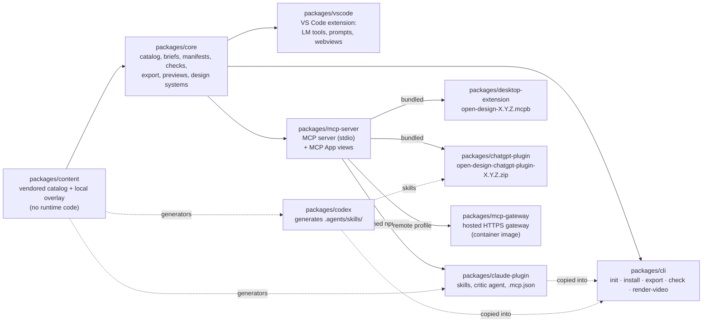
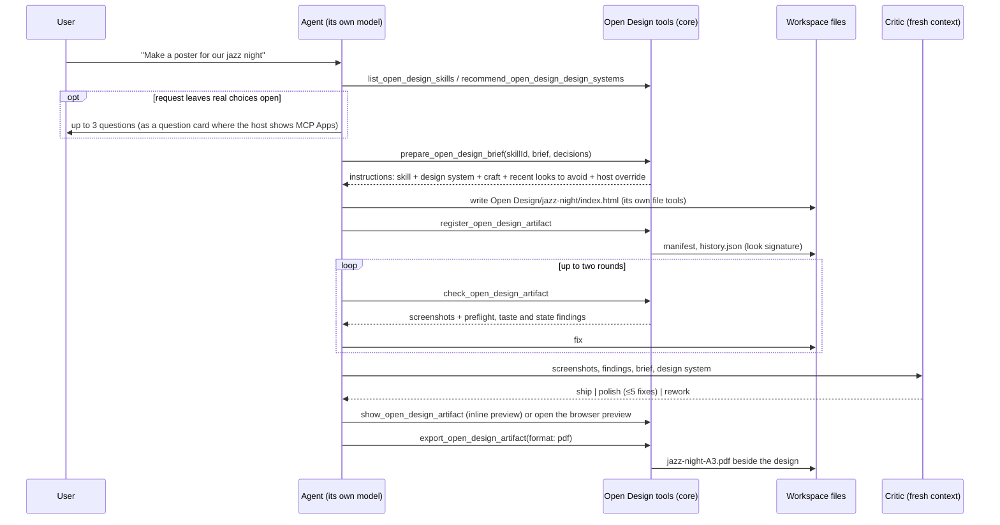
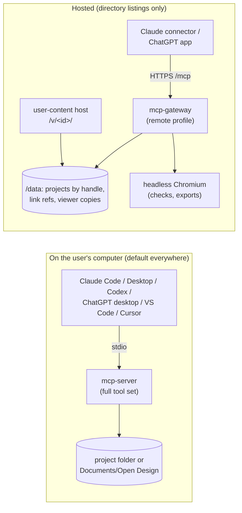

# Architecture

Open Design Agent Kit is an npm-workspaces monorepo. One framework-agnostic core does the work, a content package holds the vendored catalog, one MCP server exposes the core as tools, and thin host packages adapt both to each agent: VS Code, Claude Code, Claude Desktop, Codex, ChatGPT desktop, and a hosted gateway for the Claude and ChatGPT directory listings.

## Packages



| Package | Ships as | Role |
|---|---|---|
| `core` | not published (bundled) | Everything host-agnostic. See [Inside core](#inside-core). Its `main` is TypeScript source; every consumer bundles it with esbuild. |
| `content` | npm `@feimacode/open-design-agent-kit-content` | The vendored upstream catalog in `assets/open-design/` plus this project's overlay in `local/` (prompts, craft rules, design system fixes, descriptors, gallery settings). Data only; its scripts sync, overlay and check it. See [Content sync](content-sync.md). |
| `mcp-server` | npm `@feimacode/open-design-agent-kit-mcp`, MCP registry `io.github.feimacode/open-design` | The tools over MCP (stdio), MCP prompts, and the `ui://open-design/preview` MCP App. Reads content from the content package at runtime. |
| `cli` | npm `@feimacode/open-design-agent-kit` | `init` (writes skills and MCP config into a project), `install`/`uninstall chatgpt`, `export`, `check`, `render-video` and `preview`. Bundled like the MCP server. |
| `vscode` | VS Code extension `feima.open-design-agent-kit` | Language-model tools, chat instructions, prompt files, commands, the gallery, collections and the preview editor (webviews). Keeps its own mirror of the content, because a `.vsix` can't reach a sibling package. |
| `claude-plugin` | this repo's plugin marketplace (`/plugin install open-design`) | The hand-written overview and workflow skills, generated per-template skills, the read-only `design-critic` agent, and an `.mcp.json` that starts the MCP server pinned in the plugin's own lockfile (`scripts/open-design-mcp.mjs`). |
| `codex` | not published | Generates the repo's root `.agents/skills/` in Codex's format. |
| `desktop-extension` | `open-design-X.Y.Z.mcpb` on each GitHub release | The MCP server with its SDK inlined and the content, run on Claude Desktop's own Node. A settings form holds the Figma token (keychain) and the default design folder. |
| `chatgpt-plugin` | `open-design-chatgpt-plugin-X.Y.Z.zip` on each GitHub release | A ChatGPT "Desktop only" plugin: OpenAI's `plugin.json`, the Codex skills and the bundled server on plain `node`. `install chatgpt` unpacks it into `~/.codex/plugins/`. `--hosted <url>` builds the directory-listing variant that points at the gateway instead. |
| `mcp-gateway` | `ghcr.io/feimacode/open-design-gateway` image | The same tools over streamable HTTP for the Claude connector directory and the ChatGPT plugin directory: projects with handles, signed download links, export jobs, read-only viewer links and optional sign-in. See [Hosted server](../reference/remote-server.md). |

Every shipped artifact takes `mcp-server`'s version. The Claude plugin is the exception: it pins the server to an exact published version and moves only when [step 4 of Releasing](releasing.md#4-update-the-claude-code-plugins-mcp-pin-manual-after-npm-publish) bumps it.

## Hosts and how they reach the tools

| Host | Skills come from | Tools come from | Where designs are written |
|---|---|---|---|
| VS Code (Copilot Chat) | chat instructions and prompt files in the extension | language-model tools in the extension (no MCP) | the workspace, by the agent |
| Claude Code, Claude Desktop Code tab | the plugin, or `init --tools claude` | the plugin's pinned server, or `init`'s `.mcp.json` | the project, by the agent |
| Claude Desktop Chat or Cowork with a folder | the plugin (synced account-wide) | the plugin's server, or the `.mcpb` | `Open Design/` in the folder, by the agent |
| Claude Desktop Chat without a folder | the plugin | the `.mcpb` only | `~/Documents/Open Design/<name>/`, by the server (`write_open_design_file`) |
| Codex CLI | `.agents/skills/` from `init --tools codex` | `.codex/config.toml` | the project, by the agent |
| ChatGPT desktop (Work, Codex tabs) | the plugin zip's skills | the zip's bundled server | Documents/Open Design, or a folder the user names |
| Cursor and other MCP agents | `npx skills add …` (optional) | `npx @feimacode/open-design-agent-kit-mcp` | the project, by the agent |
| Claude and ChatGPT on the web | short server instructions and prompts | the hosted gateway | a project on the gateway, by the server |

Two rules keep these consistent:

- **One tool list.** `packages/mcp-server/src/tools.ts` defines every tool once; VS Code mirrors the same schemas as `languageModelTools`, and the docs check fails if a tool or argument is missing from [Tools](../reference/tools.md). Every tool has a `title` and `readOnlyHint`/`destructiveHint`/`openWorldHint` annotations (`toolAnnotations.ts`).
- **One set of skills.** Skills are generated from the same content for the Claude plugin, Codex and the ChatGPT zip, and `init` copies them. Lint fails when a generated copy drifts.

## Inside core

| Folder | What it holds |
|---|---|
| `content/` | `ContentIndex` (skills, templates, design systems, examples, craft), design-system matching and descriptors (`recommend_open_design_design_systems`), the paged `list_open_design_skills` payload, gallery-site settings. |
| `generation/` | Brief composition (`composeInstructions`, host overrides, brief questions and decisions), design-system tooling (tokens, previews, import from GitHub or a file, extraction from a website, the Claude Design format and its validator), explorations and style tiles, documents as sources, diagrams, Figma pull, component libraries, publish and Canva/shop hand-offs. |
| `workspace/` | Everything kept as files in the workspace: the active design system, manifests, comments, collections, check history, critiques, and design history for variety. |
| `export/` | Browser discovery, the check (`checkArtifact`, preflight and screenshots), image, PDF, PPTX, email, paste, standalone and site exports, animation capture with a virtual clock, 3D scene review. |
| `poster/` | Canvas formats and presets, print PDFs with bleed, print-house sizes, QR codes, data-driven exports, shape sheets. |
| `preview/` | The three preview surfaces: the browser preview server and its shell page, the MCP App page, and the shared bridge that injects comment and edit overlays into a design. |
| `figma/` | Capturing a page as an intermediate tree and pushing it into Figma as layers. |
| `jobs/` | Recurring design jobs: the job file, run records, period keys and the checks that settle a run. |
| `integrations/` | The registry of trusted connectors (Canva, Figma, Notion, Drive, Slack, posting services, Shopify) and how to detect them. |
| `vendored/` | Code ported from upstream Open Design, recorded in `SOURCE.md`. See [Upstream ports](upstream-ports.md). |

## How a generation flows



The quality steps, and where they live:

- **Questions first** (`add-brief-questions`): each surface has two or three questions with defaults; the agent asks only what the request doesn't answer, and passes the rest on as stated assumptions, kept in the manifest's `metadata.brief`.
- **Variety** (`add-variety-memory`): registering writes a small look signature to `.open-design/history.json`; the next brief lists recent looks to differ from, unless the design system or the user decides the look.
- **Checks** (`add-taste-checks`, `add-state-accessibility-checks`): the in-page scripts and preflight in `poster/pageScripts.ts` and `poster/preflight.ts` add "default AI look" warnings and hover, focus, tap-target, 320 px reflow and reduced-motion checks to the render findings.
- **Second opinion** (`add-design-critic`): the `open-design-critique` skill hands the latest check to a critic with no conversation context (the plugin's `design-critic` agent in Claude Code, a subagent or a labelled self-review elsewhere). The verdict is kept in `metadata.critique`.
- **Evals** (`add-output-quality-evals`): `npm run evals` runs fixed briefs through Claude Code and scores the results with the same checks. See [Contributing](README.md#evals).

## Previews

| Surface | Host | How it works |
|---|---|---|
| Preview editor, gallery, collections | VS Code | Webviews in `packages/vscode/src/webview/`, styled after Open Design's own visual language (below). |
| Browser preview | Claude Code, Codex, Cursor, the Code tab's Browser pane | A local server (`preview/server/previewServer.ts`) serves a shell page around the design, with live reload, click-to-comment, checks and before/after screenshots. `set_up_open_design_browser_pane` writes a `.claude/launch.json` entry on a per-project port. |
| Inline preview (MCP App) | Claude Desktop Chat and Cowork; ChatGPT where it renders MCP Apps | One `ui://open-design/preview` resource with views: `artifact`, `exploration`, `examples`, `design-systems`, `campaign` and `ask`. A show tool returns only the view and its filters; the page fetches data through app-only tools (`get_open_design_preview_state`, `save_open_design_comment`) that hosts keep out of the model's tool list. The artifact view polls for revisions so a shown design updates in place. |

The MCP App is offered only to clients that declare MCP Apps support; others get a text fallback. `scripts/probe-mcp-apps-host/` records what a given host actually supports (subframes, fullscreen, links, `window.openai`).

### VS Code visual language

The Artifact Preview editor, the Gallery grid and the example preview panel follow Open Design's own visual language, transcribed from its stylesheets:

- near-black and near-white "ink" buttons, with a pill-shaped primary action;
- a lime brand accent (`#87ea5c`) reserved for active and selected states;
- a terracotta (`#d96a46`) teardrop for comment pins;
- frosted-glass floating panels and a named radius ladder from 2 to 16 px;
- Albert Sans (SIL OFL, vendored) at weight 600.

They switch between Open Design's light and dark token sets based on VS Code's theme kind, rather than taking colors from the active theme. Gallery thumbnails are rendered from the bundled assets into `iframe.srcdoc`, lazily as cards scroll into view.

## Local and hosted



The gateway reuses the MCP server's tool code with `OPEN_DESIGN_PROFILE=remote` (`packages/mcp-server/src/remote.ts`). That profile hides every tool that needs the user's own disk, accounts or a browser window, refuses arguments that would make the server fetch arbitrary URLs, and enforces per-project limits. The gateway adds what a server without a user folder needs: `start_open_design_project` handles instead of MCP sessions (so a restart costs no work), signed download links, an export queue with job ids, a viewer on a separate registrable domain, and RFC 9728 sign-in metadata when sign-in is on. State is plain folders, with no database.

## Static builds

Two things are generated from the content and committed or deployed, never hand-edited:

- **`claude-design-systems/`**: every bundled design system in Claude Design's Design System format (`project/design-system.json`, `tokens.json`, `README.md`, a cover), built by `scripts/build-claude-design-systems.ts` during `npm run sync-content` and checked by lint.
- **The gallery site**: `scripts/build-gallery.ts` builds a hub-and-spoke site of design systems and examples, with `gallery.json` for agents, deployed to GitHub Pages by the **Gallery** workflow. See [gallery/README.md](../../gallery/README.md).

## Design principles

- **The agent writes the design.** Tools return instructions and do bookkeeping; they never generate HTML. There's no model, API key or daemon in this project. The one exception is where the agent can't reach the files (Chat without a folder, the hosted gateway): there `write_open_design_file` writes the agent's bytes unchanged, under the design's folder only.
- **Everything is a file.** Artifacts, manifests, comments, critiques, history, custom design systems and exports are plain files, locally and on the gateway.
- **Native per host.** VS Code gets language-model tools, prompt files and a walkthrough; Claude Code gets a plugin with skills and an agent; Claude Desktop gets the plugin plus an optional `.mcpb`; Codex and ChatGPT get skills plus a bundled server; everything else gets MCP.
- **Local by default.** The hosted gateway exists for the two directory listings. Every installable surface keeps the local server.
- **Checked, not just generated.** Every design is rendered and looked at before the user hears it's done.
- **Nothing drifts silently.** Generated or mirrored content, and the docs' reference pages, are checked by `npm run lint`. See [Content sync](content-sync.md).
- **Upstream stays upstream.** Vendored content is never hand-edited; our additions live in an overlay, and ported code is attributed. See [Upstream ports](upstream-ports.md).

Design decisions and their reasoning live as OpenSpec changes in `openspec/changes/` (proposal, design, tasks and spec deltas per change); finished ones move to `openspec/changes/archive/`.

## Development

```bash
npm install
npm run typecheck      # every workspace
npm run lint           # eslint + every drift check + the docs check
npm run test:unit      # every workspace's tests + the docs check's tests
npm run compile        # builds the VS Code extension
```

- **VS Code:** press F5 ("Run Extension") to start an Extension Development Host.
- **MCP server:** `npm run compile --workspace=@feimacode/open-design-agent-kit-mcp`, then `node packages/mcp-server/out/index.js` (stdio).
- **Claude plugin:** `claude --plugin-dir ./packages/claude-plugin`; validate with `claude plugin validate ./packages/claude-plugin` and `claude plugin validate .`.
- **Desktop extension and ChatGPT plugin:** both bundle the content package's tarball. Run `npm pack --workspace=packages/content`, then `npm run build --workspace=packages/desktop-extension -- --content <content.tgz> --out /tmp/od.mcpb` (or `--workspace=packages/chatgpt-plugin … --out /tmp/od-chatgpt.zip`), and smoke-test with `node scripts/test-mcpb.mjs` or `node scripts/test-chatgpt-plugin.mjs` on the result.
- **Gateway:** `npm run compile --workspace=@feimacode/open-design-gateway`, then `OPEN_DESIGN_LINK_SECRET=$(openssl rand -hex 16) node packages/mcp-gateway/out/index.js`, or build the container as in [deploy/README.md](../../deploy/README.md).
- Core's export tests launch a real browser when one is installed and skip otherwise. Its deck smoke test exports ten bundled decks, which takes about a minute. As root (for example in a container), point `OPEN_DESIGN_BROWSER_PATH` at a wrapper that adds `--no-sandbox`.
